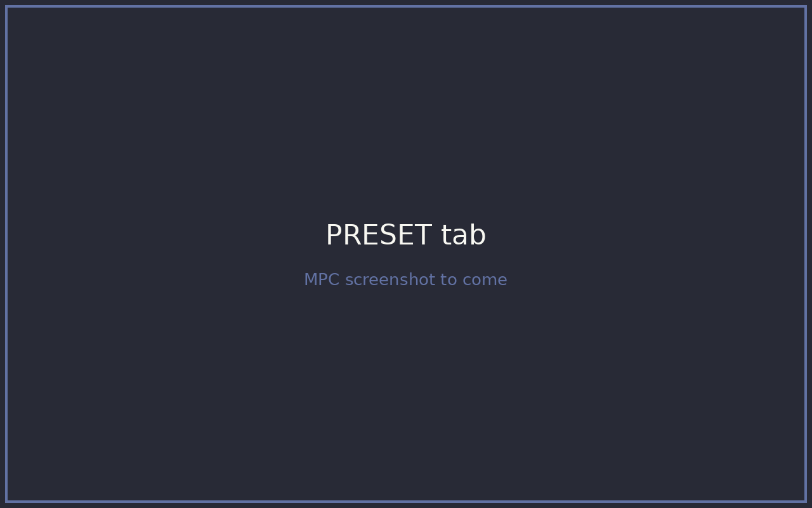
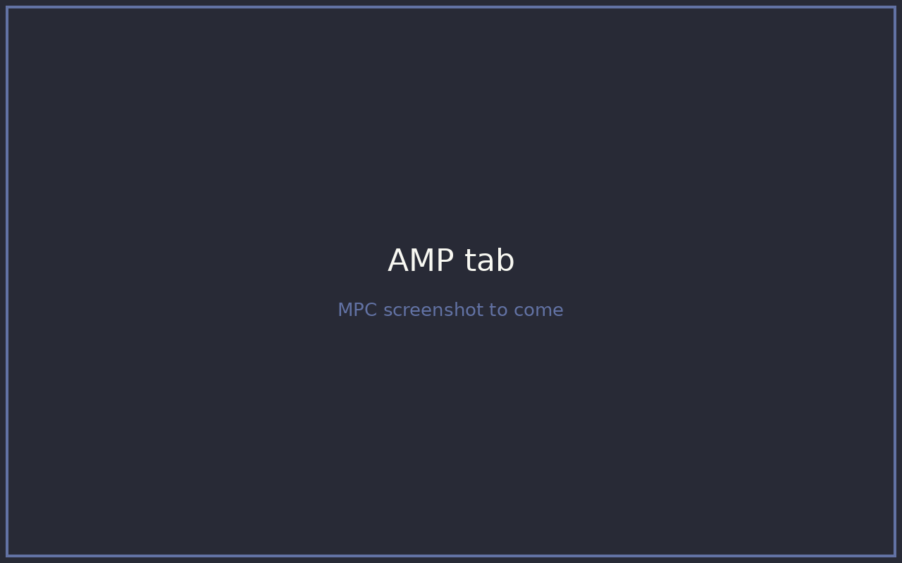
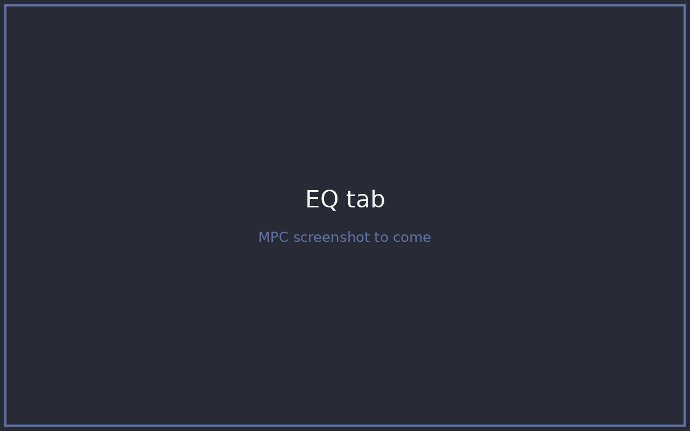
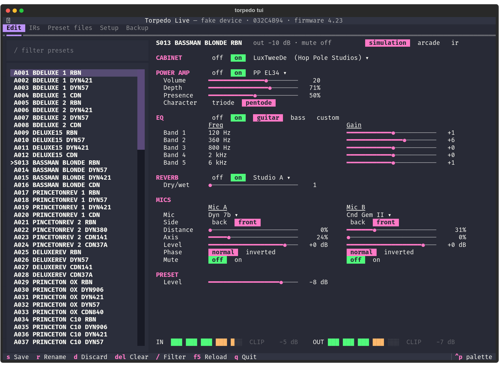
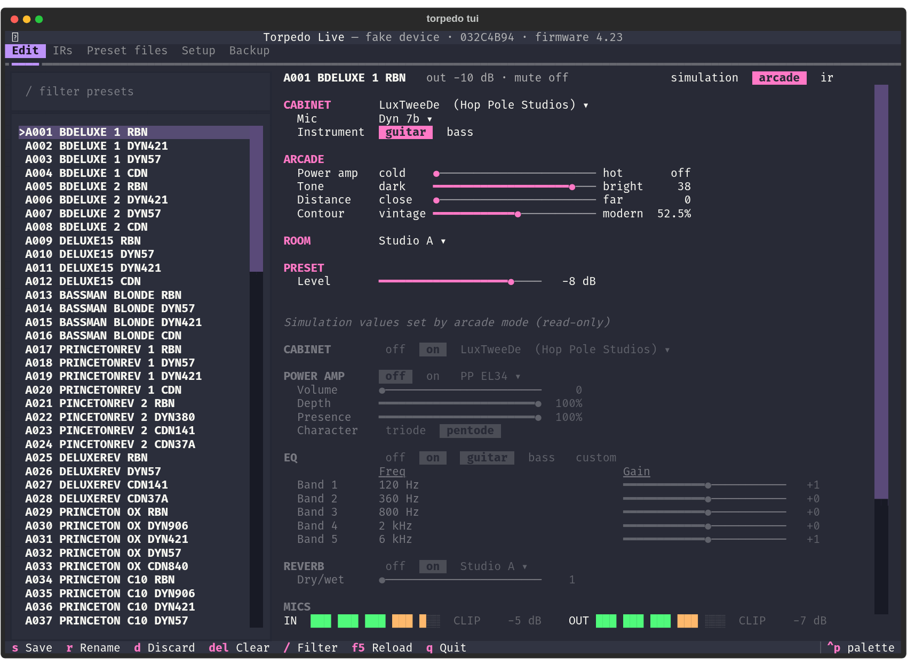

# torpedo

Control a Two notes **Torpedo Live** without Torpedo Remote: from an Akai MPC's
touchscreen and Q-Links, or from a Linux (or Windows) computer.

The Torpedo Live is a loadbox and cab simulator that Two notes no longer makes.
Its only editor, Torpedo Remote, runs on Windows and macOS. This project
reverse-engineers its USB HID protocol (by watching what Remote sends) and
builds two front ends on it:

- **An MPC plugin** (the main point): a VST2 plugin for MPC OS that shows the
  unit's parameters and presets on the MPC's screen, with the Torpedo plugged
  into the MPC's USB port. No computer involved.
- **A Python CLI and TUI** (the proof of concept, still a good way to drive the
  unit from a computer): edit, save, back up and restore presets, manage IRs and
  global settings.

> [!NOTE]
> This is ultra niche. It has only been tested with **one Torpedo Live on
> firmware 4.23** and **an MPC Key 37 on MPC OS 3.9.1**. Other MPC OS devices
> run the same program and may work, but nobody has tried. Not affiliated with
> Two notes Audio Engineering or Akai Professional.

## MPC plugin

| PRESET | AMP | EQ |
|---|---|---|
|  |  |  |

<!-- confirm: placeholders until screenshots are grabbed from the Key 37 (same file names) -->

The plugin is a silent instrument that you add to a track like any other
plugin. Audio still goes through the Torpedo as usual; the plugin only talks to
it over USB (`/dev/hidraw`), from a worker thread. It follows changes made on
the unit's front panel and reconnects by itself when the Torpedo is replugged.

The page has one tab per area, laid out for the MPC rather than copied from
Remote's rack:

| Tab | What it holds |
|---|---|
| PRESET | 16 tiles per bank (tap to load), SAVE, SAVE AS, DISCARD, RENAME and CLEAR PRESET, each behind a confirm; an on-screen keyboard for names |
| ARCADE | arcade mode's cab, mic and four macros |
| AMP | power amp, reverb, preset and output levels |
| CAB | the cab and both mics |
| IR | IR mode's two IR slots and their mix |
| EQ | the 5-band EQ (guitar, bass or custom) and the low cut |

Each panel is one Q-Link group: touching a control picks its group, and the
MPC's Q-Link button steps through them. A tab that doesn't apply to the current
preset's mode shows the values that mode sets (read only) or a placeholder.

**Not covered** (use the CLI or TUI): IR upload, preset files, backups and
the MIDI and S/PDIF settings. The plugin doesn't save anything in the MPC
project either: the Torpedo keeps its own presets.

### Build and install

There is no release: build it from source. You need root SSH access to the MPC
(see [mpc-vst-plugins](https://github.com/sd88me/mpc-vst-plugins)), plus
[uv](https://docs.astral.sh/uv/), Chromium and Make on the build machine. Zig
comes from PyPI through `uvx`, so no Docker or cross toolchain is needed.

```sh
git submodule update --init          # mpc/mpc-vst-plugins: the VST2 wrapper and skin generator
make -C mpc plugin                   # -> mpc/plugin/build/plugin/ygn - VST - Torpedo Control/
```

Copy that folder into a `Synths` folder on the MPC (on the Key 37,
`/storage/Synths/`), then register it with upstream's `mpc-store.sh`, run on
the MPC:

```sh
sh mpc-store.sh -t /storage/Synths sync
```

Plug the Torpedo into a USB host port of the MPC, add **Torpedo Control** to a
track <!-- confirm: how it shows in MPC's plugin browser (vendor "ygn") --> and
the page switches from "not connected" to the current preset.

## Linux CLI and TUI



The Python package works anywhere hidapi does: Linux was the goal, and it runs
on Windows too. It needs Python 3.13 and [uv](https://docs.astral.sh/uv/).

On Linux, hidapi opens the kernel's `hidraw` devices, which are root-only by
default. Install the udev rule once:

```sh
sudo cp linux/70-torpedo-live.rules /etc/udev/rules.d/
sudo udevadm control --reload && sudo udevadm trigger   # then replug the Torpedo
```

### CLI

```sh
uv run torpedo info                          # serial, firmware, current preset
uv run torpedo params                        # every parameter of the current preset, with ranges
uv run torpedo get arcade_contour 0x1d       # by name (case-insensitive) or index
uv run torpedo set arcade_contour=22 reverb_room=3
uv run torpedo discard                       # leave unsaved edits (reloads the preset)
uv run torpedo preset 2                      # select A002 (or `preset A002`)
uv run torpedo presets                       # preset names (--all: also the empty USER slots)
uv run torpedo save --name "my crunch"       # store into the first empty USER slot
uv run torpedo save A080 --overwrite         # replace a preset (refused without --overwrite)
uv run torpedo rename "my crunch 2"          # rename the current preset (no unsaved edits)
uv run torpedo clear A080 --yes              # empty a preset like Remote's Delete
uv run torpedo cabs                          # the cabs, * = current
uv run torpedo cab darkprinz                 # select by index, name or unique part of it
uv run torpedo irs                           # the IRs, with the IR mode slots using them
uv run torpedo ir 1 v30-906-e                # load an IR into slot 1 (IR mode)
uv run torpedo ir-get v30-906-e out.wav      # download an IR (float WAV, like Remote's export)
uv run torpedo ir-put my-cab.wav --align min-phase   # upload a WAV (any rate)
uv run torpedo ir-delete MY-CAB              # exact name; refuses if later IRs would renumber
uv run torpedo export presets/crunch.json    # the current sound (unsaved edits included)
uv run torpedo import presets/crunch.json A080   # store a preset file into a slot
uv run torpedo backup backup/today.json      # all presets + global settings (~20 s)
uv run torpedo restore backup/today.json     # dry run: what differs (--apply writes it)
uv run torpedo setup midi_channel=1 output=wet/wet spdif_freq=96 level=85 mute=off
uv run torpedo --fake params                 # simulated device, nothing is sent
```

`set` edits the unit's edit buffer only, until `save` stores it. Every value is
range-checked before anything is sent, and in arcade mode the parameters the
Torpedo would ignore are refused. `save` only writes into an empty "USER" slot
unless told to `--overwrite`; names are A-Z, 0-9 and spaces, up to 25
characters.

Presets have three modes: simulation (one cab, two mics), arcade (four macros
driving the simulation values) and IR (two IR slots). They are labelled like
the unit's panel: S013, A001, I020.

### TUI



`uv run torpedo tui` (`--fake tui` without a unit) shows the presets on the
left and the current one on the right, laid out like Remote's rack for its
mode; in arcade mode the simulation values it computes are listed below,
dimmed. ↑/↓ move, ←/→ change a value (shift: ×10), Enter types a number or
opens a filterable list (cab, mic, IR, amp, room), Space toggles. `s` saves,
`r` renames, `d` discards, Del clears the highlighted preset, `/` filters.
Front-panel changes show up highlighted, and the meters under the editor mirror
the unit's LEDs. Other tabs: IRs, Preset files, Setup and Backup.

### IRs, preset files and backups

- **IRs** live in bank 1 after the 86 ML IRs. `ir-put` does what Remote does
  to a file: resampling to 48 kHz, alignment (`original`, `min-latency` or
  `min-phase`), cut or pad to 20 or 40 ms and peak normalization, in plain
  Python. Deleting an IR moves the following ones down a place, so presets
  using them would play the next one.
- **Preset files** (`export`/`import`) are one sound per JSON file, naming the
  cab, mics and IRs so they move between units; `import` refuses a file whose
  cab or IR this unit lacks. Remote's `.top` format is not supported.
- **Backups** hold all 128 presets and the global settings, by bank position,
  so they are meant for the unit they came from. `restore` only stores the
  presets that differ. The unit has no other way to send a stored preset, so
  `backup` selects each one in turn.

## How it works

`PROTOCOL.md` is the decoded protocol: 64-byte HID reports, parameter
indexes and ranges, presets, names, IRs, setup, meters and front-panel
messages. It comes from recording Torpedo Remote's traffic on Windows with
Frida (`tools/hidspy.py`, which only observes) and the logs in `captures/`.
The client never sends a command type that hasn't been seen in a capture:
the firmware also has update, factory reset and erase commands whose IDs are
unknown, and it may accept out-of-range values.

`src/torpedo/protocol.py` holds the tables; the MPC side's C tables are
generated from it (`mpc/gen_tables.py`), as is the plugin's parameter list
(`mpc/plugin/gen_plugin.py`, from `src/torpedo/layout.py`).

## Repository layout

| Path | What it holds |
|---|---|
| `src/torpedo/` | Python package: protocol tables, device layer, emulator (`fake.py`), CLI, TUI (`tui/`) |
| `mpc/core/` | C core shared by the plugin and tools: hidraw transport, exchange, worker thread and cache |
| `mpc/plugin/` | the plugin: engine, skin (`layout.conf`, `images/`) and build config |
| `mpc/probe/`, `mpc/ctl/` | a read-only probe and a stdin driver for the core, for checks on the device |
| `mpc/mpc-vst-plugins/` | submodule: [sd88me/mpc-vst-plugins](https://github.com/sd88me/mpc-vst-plugins) (VST2 wrapper, skin tools) |
| `PROTOCOL.md`, `captures/`, `tools/` | the protocol notes, Remote's recorded traffic and the capture scripts |
| `backup/` | backups of the author's unit |
| `linux/` | udev rule |
| `tests/` | tests against the emulator, for both the Python and C sides |

## Development

```sh
uv run pytest                  # everything, against the emulated Torpedo (src/torpedo/fake.py)
make -C mpc host               # C probe and ctl with ASan/UBSan (tests/test_mpc*.py)
make -C mpc plugin-host        # the plugin in a stand-in host (tests/test_mpc_plugin.py)
make -C mpc tsan               # the core's worker thread under ThreadSanitizer
```

The emulator answers at the HID report level and raises on any command that
was never observed, so the tests also check that nothing unknown gets sent.
The skin is edited in mpc-vst-plugins' skin studio
(`tools/studio.py serve plugin/layout.conf --params plugin/params.json`, run
from `mpc/`).

## License

[CC0 1.0](LICENSE): public domain, do what you like with it. The
`mpc/mpc-vst-plugins` submodule is MIT licensed, and its VST2 wrapper is built
into the plugin, so a plugin build carries its notice too.

Torpedo, Torpedo Live and Torpedo Remote are trademarks of Two notes Audio
Engineering; MPC is a trademark of inMusic Brands.
